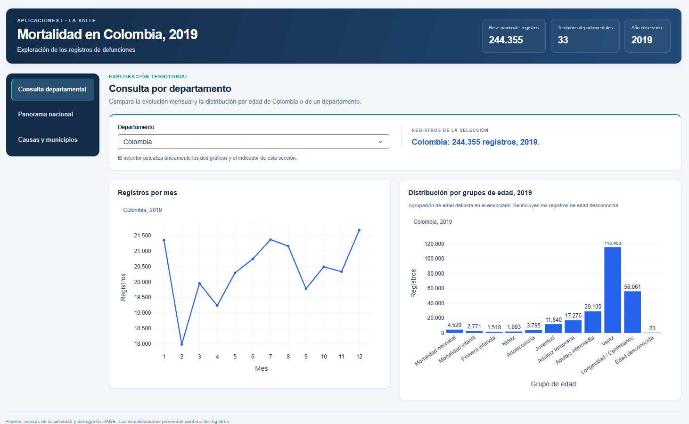
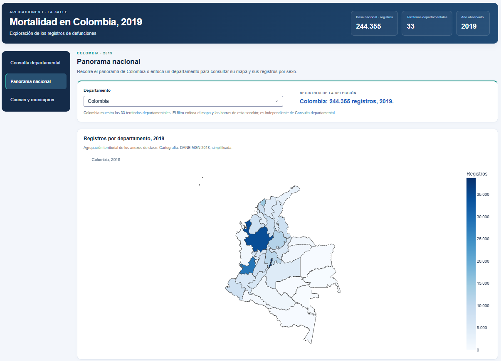
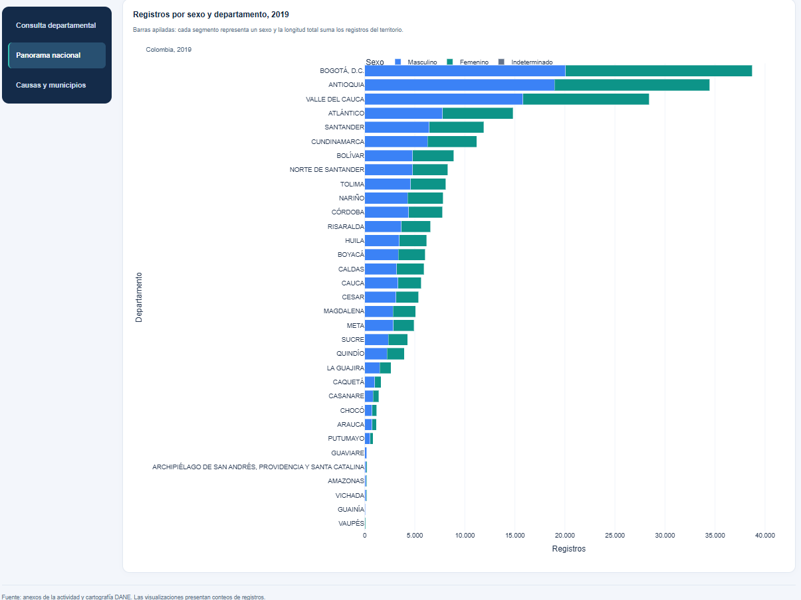
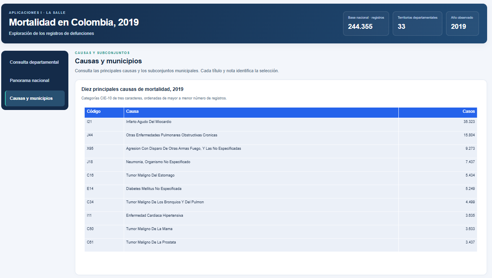
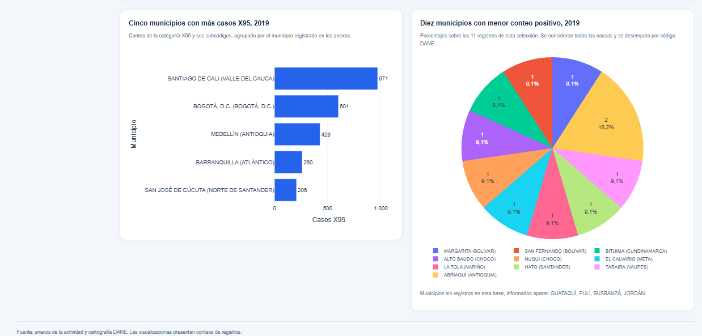
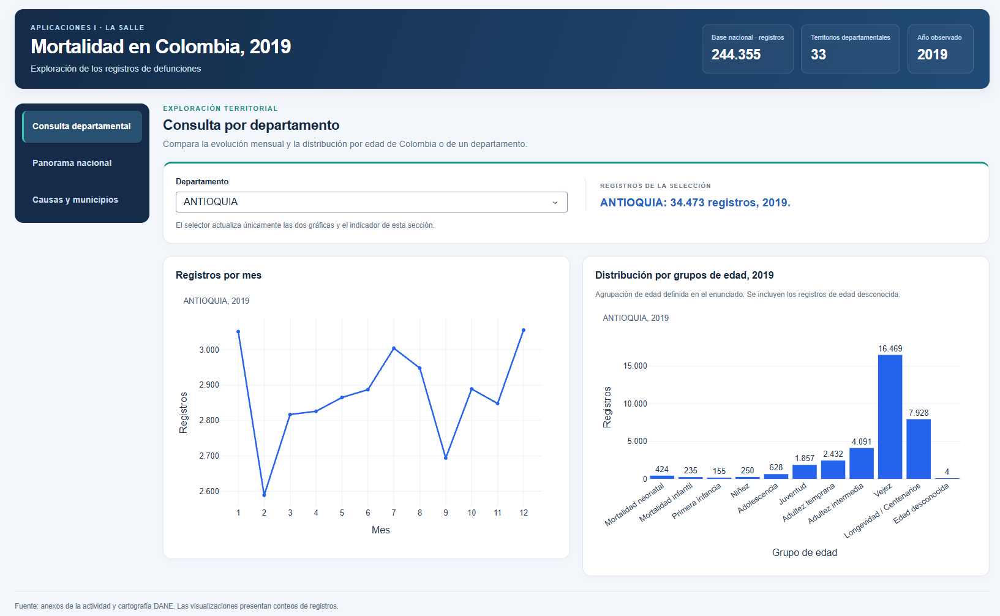
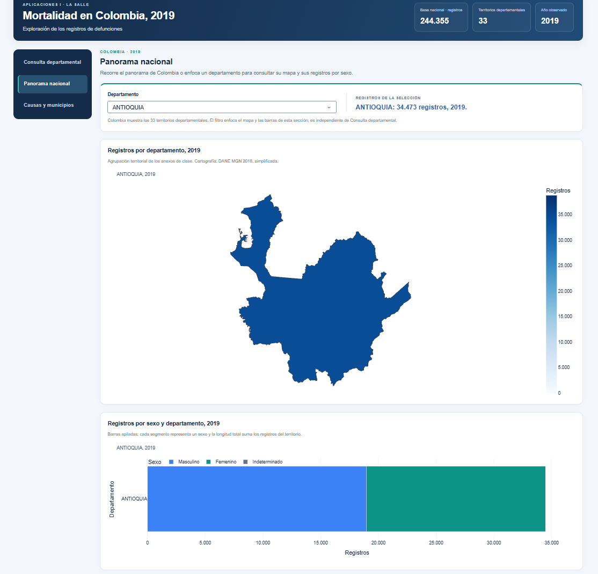

# Mortalidad en Colombia, 2019

## Introducción

Proyecto académico de Aplicaciones I de la Maestría en Inteligencia Artificial de la Universidad de La Salle. La aplicación web interactiva utiliza Python, Plotly y Dash.

Autor: Juan Diego Londoño Alvarez.

## Objetivo

Explorar la mortalidad en Colombia durante 2019 mediante visualizaciones de su distribución territorial, evolución mensual, causas de muerte, sexo y grupos de edad.

## Estado del proyecto

La aplicación muestra siete vistas: evolución mensual, mapa departamental, barras por sexo y departamento, distribución por edad, tabla de diez causas, barras de cinco municipios por X95 y circular municipal.

La base contiene 244.355 registros, incluidos 93 de sexo indeterminado y 23 de edad desconocida. Las vistas de principales causas y municipios muestran los subconjuntos indicados en sus títulos.

La aplicación está publicada en [Render](https://mortalidad-colombia-2019-rqso.onrender.com/). El código del diseño por secciones y de la revisión corresponde al hito `f7c3d28`, subido y comprobado en línea con las siete vistas y los dos filtros independientes.

El dashboard organiza las siete visualizaciones en tarjetas, adapta su distribución al ancho de la ventana y tiene tres secciones:

| Sección | Vistas y alcance |
| --- | --- |
| Consulta departamental | Un selector actualiza la línea mensual, la distribución por grupos de edad y el indicador para Colombia o un departamento. |
| Panorama nacional | Un selector propio actualiza el mapa, las barras apiladas por sexo y el indicador. El mapa aparece arriba y las barras debajo, a todo el ancho. |
| Causas y municipios | Tabla de diez causas, barras de cinco municipios X95 y circular de diez municipios con menor conteo positivo. Conservan sus selecciones y no dependen de los filtros. |

Los dos filtros son independientes y recuerdan su selección al volver entre secciones de la misma página. Esa memoria se reinicia al recargar. Los indicadores del encabezado conservan su alcance nacional.

Las gráficas ocupan marcos dimensionados mediante CSS. En Panorama, el marco de las barras por sexo utiliza 1050 px para Colombia; al consultar un departamento, el callback ajusta ese marco a 340 px. Al volver a Colombia, la altura vuelve a estar definida por el CSS.

La versión se comprobó en local y en Render, incluidos los filtros independientes y el regreso de un departamento a Colombia en Panorama, con recuperación de las 33 barras. La sección de visualizaciones documenta las siete vistas mediante cinco capturas propias y sus interpretaciones, además de dos capturas con Antioquia seleccionado: una de Consulta departamental y otra de Panorama nacional. Las visualizaciones y sus resultados fueron revisados por el autor. También se comprobó la instalación y el arranque desde una copia nueva, con entorno propio y sin los Excel originales; el autor confirmó las vistas y los filtros en esa copia.

## Entorno de desarrollo

Python 3.14.0, Dash 4.4.1, Plotly 7.1.0 y pandas 3.1.0. El preparador de datos utiliza openpyxl 3.1.5. Las versiones completas, incluidas dependencias transitivas, están registradas en `requirements.txt`; Gunicorn 26.2.0 se instala en plataformas distintas de Windows para el servidor de Render.

## Software utilizado

- Windows y PowerShell para el trabajo local y los comandos.
- Visual Studio Code para editar y organizar el proyecto.
- Git para el control de versiones y GitHub para alojar el repositorio.
- Python y las bibliotecas indicadas en el entorno de desarrollo.
- Render para publicar la aplicación como servicio web.

El descargador opcional de cartografía utiliza Requests 2.34.2. Las dependencias para ejecutar la aplicación y utilizar los auxiliares se conservan en el mismo `requirements.txt`.

## Estructura actual

- `app.py`: conexión de los datos y las figuras con la interfaz de Dash.
- `src/interfaz.py`: componentes, tarjetas, tres secciones y dos selectores independientes; marcos de las siete figuras.
- `src/datos.py`: lectura de mortalidad y catálogos, validaciones, resúmenes y selección de municipios.
- `src/graficos.py`: construcción de la línea mensual, mapa, barras por sexo y por X95, distribución de edad, tabla de causas y circular municipal; adaptación de la cartografía para Plotly.
- `src/descargar_geografia.py`: descarga y comprobación de los límites departamentales.
- `src/explorar_datos.py`: registro diagnóstico opcional de la exploración de hojas, categorías, conteos y correspondencias; no interviene en el arranque.
- `data/geo/`: cartografía departamental del DANE, versión 2018, descargada con simplificación.
- `data/raw/`: copias sin modificar de los Excel, excluidas de Git.
- `data/processed/`: diez CSV estadísticos utilizados por la aplicación.
- `src/preparar_publicacion.py`: genera los CSV desde los anexos locales y comprueba sus totales.
- `src/datos_publicacion.py`: lee los CSV, conserva los códigos como texto y convierte las cantidades a enteros.
- `assets/estilos.css`: estilos del encabezado, navegación, tarjetas y alturas de los marcos. El callback de Panorama ajusta la altura de sexo para el detalle departamental.
- `docs/capturas/`: carpeta destinada a las capturas de la versión publicada.
- `.python-version`: versión de Python indicada para Render.
- `requirements.txt`: paquetes y versiones del entorno.

## Instalación y ejecución local

### Copia nueva en Windows

Se requieren Git, Python 3.14 y conexión a Internet para instalar las dependencias. El desarrollo se realizó con Python 3.14.0.

Abre PowerShell en una carpeta distinta de la copia de trabajo actual y comprueba los comandos disponibles:

```powershell
git --version
python --version
```

Comprueba que `python --version` indique Python 3.14 antes de crear el entorno. Si el comando corresponde a otra versión o no está disponible, configura primero Python 3.14 siguiendo la [documentación oficial para Windows](https://docs.python.org/3.14/using/windows.html).

Desde una carpeta que no contenga ya una copia con el nombre `mortalidad-colombia-2019`, clona el repositorio y entra en la carpeta creada:

```powershell
git clone https://github.com/Juandi051400/mortalidad-colombia-2019.git
cd mortalidad-colombia-2019
```

En esa copia nueva, crea su entorno e instala las dependencias:

```powershell
python -m venv .venv
.\.venv\Scripts\python.exe -m pip install -r requirements.txt
```

`venv` crea un entorno de paquetes para esa copia. Los comandos usan directamente su intérprete de Windows, conforme a la [documentación de entornos virtuales de Python 3.14](https://docs.python.org/3.14/library/venv.html).

Ejecuta la aplicación:

```powershell
.\.venv\Scripts\python.exe .\app.py
```

Abre la [dirección local de Dash](http://127.0.0.1:8050/) en el navegador. Para detener el servidor, utiliza `Ctrl+C` en la terminal.

El arranque utiliza los CSV y el GeoJSON incluidos en el repositorio. La regeneración de los CSV a partir de Excel es un procedimiento separado, descrito en la sección siguiente.

### Entorno ya preparado

Para volver a ejecutar una copia que ya tiene su entorno y dependencias, abre PowerShell en la raíz del proyecto y utiliza:

```powershell
.\.venv\Scripts\python.exe .\app.py
```

### Comprobación realizada desde una copia nueva

El 1 de noviembre de 2026 se comprobó una copia separada del repositorio en Windows con Python 3.14.0, dentro de la carpeta `mortalidad-colombia-2019-prueba`. Se creó su propio entorno `.venv`, se instalaron las dependencias de `requirements.txt` y se ejecutó `app.py` con el intérprete de esa copia.

La instalación terminó con `Successfully installed` y el servidor mostró `Dash is running on http://127.0.0.1:8050/`. El autor abrió la aplicación y confirmó que las vistas y los filtros funcionaban como en la versión revisada. La copia no contiene `data/raw/`: utiliza los CSV y el GeoJSON incluidos en el repositorio. La copia de trabajo y su entorno se conservaron.

## Datos de entrada y reproducción

La aplicación lee diez CSV estadísticos de `data/processed/` y la cartografía de `data/geo/`. Los CSV contienen resúmenes separados para las visualizaciones y una lista de municipios de referencia.

Para regenerar estos archivos se utilizan los tres Excel proporcionados para la actividad:

- `Anexo1.NoFetal2019_CE_15-03-23.xlsx`: base de defunciones.
- `Anexo2.CodigosDeMuerte_CE_15-03-23.xlsx`: catálogo de códigos y nombres de causas de muerte.
- `Divipola_CE_.xlsx`: códigos y nombres de departamentos y municipios.

Los Excel originales se conservan en `data/raw/`, excluida de Git. El arranque de la aplicación utiliza los CSV preparados.

Con el entorno de desarrollo preparado y los Excel disponibles, los resúmenes se regeneran desde la raíz del proyecto mediante:

`.\.venv\Scripts\python.exe -m src.preparar_publicacion`

El preparador comprueba los totales correspondientes a cada resumen. El lector conserva los códigos como texto y convierte MES/CASOS a enteros.

Documentación de referencia: [DANE — Estadísticas Vitales 2019](https://microdatos.dane.gov.co/index.php/catalog/696).

Fuente: Departamento Administrativo Nacional de Estadística: www.dane.gov.co .

## Despliegue utilizado en Render

El servicio existente se creó desde **New → Web Service**, conectando el repositorio de GitHub. La configuración utilizada sigue el flujo de la [guía oficial de despliegue de Python con Gunicorn en Render](https://render.com/docs/deploy-flask).

| Campo | Valor utilizado |
| --- | --- |
| Repositorio | `Juandi051400/mortalidad-colombia-2019` |
| Branch | `main` |
| Language | `Python 3` |
| Region | `Ohio` |
| Root Directory | Vacío: se utiliza la raíz del repositorio. |
| Build Command | `pip install -r requirements.txt` |
| Start Command | `gunicorn app:app --bind 0.0.0.0:$PORT --workers 1` |
| Compute | `Free` |
| Versión de Python | `3.14.0`, indicada en `.python-version`. |

Render permite fijar la versión de Python mediante `.python-version`, como se documenta en su [configuración oficial de Python](https://render.com/docs/python-version). Los CSV y el GeoJSON versionados forman parte de las entradas del despliegue.

Después de completar los campos, se inició el despliegue y se esperó el estado **Live**. La URL del servicio es [mortalidad-colombia-2019-rqso.onrender.com](https://mortalidad-colombia-2019-rqso.onrender.com/).

Para cada actualización, se suben los cambios a `main`, se revisa el despliegue correspondiente en Render y se comprueba la aplicación pública. Tras subir `f7c3d28`, se verificaron las tres secciones, los filtros independientes, el regreso al panorama de Colombia y las siete vistas con sus encabezados y notas.

En la instancia Free, Render pausa el servicio después de 15 minutos sin tráfico. La siguiente visita lo reactiva y puede necesitar alrededor de un minuto para cargar. Estas condiciones están descritas en la [documentación actual de Render Free](https://render.com/docs/free).

## Cartografía del mapa

Fuente: Departamento Administrativo Nacional de Estadística (DANE), capa Departamento del [servicio geográfico MGN2019](https://geoportal.dane.gov.co/mparcgis/rest/services/MGN2019/Serv_CapasMGN_2019/FeatureServer/319).

El atributo DPTO_NANO identifica la versión cartográfica como 2018. Los registros de mortalidad analizados corresponden a 2019.

La descarga solicita coordenadas geográficas EPSG:4326, una tolerancia de simplificación de 0.005 grados y cinco decimales para facilitar la visualización web.

El GeoJSON guardado conserva esa descarga simplificada. Para dibujarlo, src/graficos.py adapta la orientación de los contornos sobre una copia en memoria, conservando el archivo descargado y los conteos.

Consulta las [condiciones de uso del Geoportal DANE](https://geoportal.dane.gov.co/acerca-del-geoportal/licencia-y-condiciones-de-uso/).

## Agrupación por edad

Se utilizan las once categorías definidas en el enunciado. Se conserva «Edad desconocida» (código 29), con 23 registros. La gráfica presenta conteos absolutos por categoría; los grupos de edad conocida abarcan intervalos de distinta duración.

## Criterios de causas y municipios

Las causas se agrupan por categorías CIE-10 de tres caracteres. Durante la preparación de los CSV, en memoria se ajustan un espacio final del catálogo, las variantes textuales de T81/X16 y cinco correspondencias de aterosclerosis a I70, contrastadas con la [CIE-10 de OPS](https://ais.paho.org/classifications/chapters/CAP09.html). Los Excel originales se conservan.

Los territorios se relacionan mediante COD_DANE completo. Mapiripana conserva su código histórico 94663 y se completa su tipo como área no municipalizada, según la [nota de DANE](https://microdatos.dane.gov.co/index.php/catalog/743/variable/F48/V4740?name=NPCEP9B).

El ranking X95 incluye ese código y sus subcódigos: 9.273 registros en total. Representa ese subconjunto de causas, sin equipararlo al total de homicidios.

Para la circular, ante la ausencia de una fórmula en el enunciado, se adopta el menor conteo absoluto de todas las causas entre municipios con registros positivos. Se ordena por casos y se desempata por código DANE. Los diez seleccionados reúnen once registros; los porcentajes corresponden a esa selección.

Guataquí, Pulí, Busbanzá y Jordán se informan aparte como municipios sin registros en esta base. Nuevo Belén de Bajirá se excluye de esa referencia de 2019 por su [creación en 2023](https://www.registraduria.gov.co/8-972-ciudadanos-estan-habilitados-para-votar-en-las-primeras-elecciones-de.html). Estos resultados describen registros de los anexos y no constituyen tasas de mortalidad.

## Visualizaciones y resultados

Las primeras cinco capturas muestran las siete visualizaciones de la aplicación publicada; las figuras 6 y 7 documentan Antioquia en cada una de las dos secciones con filtro. Se conservan los encuadres aportados por el autor: dos imágenes reúnen parejas de gráficos, con títulos, ejes, notas y leyendas visibles. Las cifras de las interpretaciones proceden de los CSV agregados del proyecto; los porcentajes se calculan sobre el total indicado y se redondean a un decimal.

### Consulta departamental: evolución mensual y grupos de edad



*Figura 1. Consulta de Colombia con el selector, el indicador de 244.355 registros y las dos visualizaciones completas.*

**Evolución mensual.** La línea distribuye 244.355 registros en doce meses: diciembre presenta el mayor conteo (21.678) y febrero el menor (17.974). Son cantidades mensuales, sin ajuste por su duración; esta comparación no demuestra estacionalidad ni explica sus causas. Fuente: [`mensual_2019.csv`](data/processed/mensual_2019.csv).

**Distribución por edad.** Las barras conservan los once grupos definidos en el enunciado, incluida Edad desconocida (23 registros). Vejez reúne 115.453 y Longevidad / Centenarios 56.061; juntos suman 171.514 (70,2 % de 244.355). Los intervalos tienen distinta amplitud: las barras no representan edades individuales ni tasas comparables por año de edad. Fuente: [`edad_2019.csv`](data/processed/edad_2019.csv).

### Panorama nacional: mapa departamental



*Figura 2. Panorama de Colombia con su selector independiente, mapa completo, escala de registros y nota cartográfica.*

El mapa colorea los 33 territorios consignados en los anexos, incluido Bogotá, según su número de registros. Bogotá reúne 38.760 y Antioquia 34.473, los dos mayores conteos. La comparación utiliza cantidades absolutas, sin poblaciones territoriales; por tanto, no identifica dónde es mayor el riesgo de mortalidad. Fuente: [`departamental_2019.csv`](data/processed/departamental_2019.csv).

### Panorama nacional: sexo y departamento



*Figura 3. Distribución por sexo y departamento en la opción Colombia. Se incluyen las 33 barras y las tres categorías de la leyenda.*

Las barras apiladas muestran la composición por sexo dentro de cada departamento; su longitud total corresponde al conteo del territorio. En el conjunto nacional hay 134.573 registros masculinos, 109.689 femeninos y 93 indeterminados. El predominio numérico masculino describe esta base y no equivale a una tasa de mortalidad por sexo. Fuente: [`sexo_departamental_2019.csv`](data/processed/sexo_departamental_2019.csv).

### Diez principales causas



*Figura 4. Tabla completa de las diez categorías CIE-10 con más registros, ordenadas de mayor a menor.*

La tabla muestra el código, el nombre y el conteo de diez categorías CIE-10 de tres caracteres. I21, infarto agudo del miocardio, encabeza el ranking con 35.323 registros, seguido de J44 con 15.804; las diez reúnen 93.724 (38,4 % de la base). Es un ranking de frecuencias de categorías que agrupan códigos más detallados; la tabla no explica los factores que originan esas diferencias. Fuente: [`causas_2019.csv`](data/processed/causas_2019.csv), primeras diez filas.

### Municipios: mayores conteos X95 y menores conteos positivos



*Figura 5. Dos selecciones municipales con alcances distintos: X95 y sus subcódigos a la izquierda; todas las causas entre municipios con conteos positivos a la derecha. La circular conserva su leyenda y la nota sobre municipios sin registros.*

**Cinco municipios por X95.** Las barras presentan los mayores conteos de X95 y sus subcódigos: Santiago de Cali 971, Bogotá 601, Medellín 428, Barranquilla 260 y San José de Cúcuta 206. Reúnen 2.466 de los 9.273 registros X95 (26,6 %). Este subconjunto no equivale al total de homicidios ni mide una tasa por habitante. Fuente: [`x95_municipal_2019.csv`](data/processed/x95_municipal_2019.csv), primeras cinco filas y total del archivo.

**Municipios con menor conteo positivo.** La circular representa once registros de diez municipios: nueve aportan uno y Abriaquí dos. Los porcentajes son 9,1 % para cada municipio con un registro y 18,2 % para Abriaquí, calculados sobre esos once, no sobre 244.355. Esta selección no constituye una tasa; los cuatro municipios sin registros, informados aparte, no prueban cero muertes reales. Fuentes: [`menores_municipios_2019.csv`](data/processed/menores_municipios_2019.csv) y [`municipios_sin_registros_2019.csv`](data/processed/municipios_sin_registros_2019.csv).

### Consulta departamental: ejemplo del filtro



*Figura 6. Estado de Consulta departamental al seleccionar Antioquia.*

El selector muestra Antioquia y el indicador presenta 34.473 registros. Los títulos de la línea mensual y de la distribución por edad identifican ese mismo departamento. Frente a la consulta de Colombia de la figura 1, esta imagen documenta el cambio de alcance de las dos gráficas y del indicador; el encabezado general conserva el total nacional de 244.355 registros. El filtro de Panorama nacional tiene su propio alcance, descrito en la sección Estado del proyecto.

### Panorama nacional: ejemplo de su filtro



*Figura 7. Panorama con Antioquia seleccionado. Se muestran el mapa y la barra por sexo del departamento; el encabezado conserva sus indicadores nacionales.*

Al seleccionar Antioquia en el control de Panorama nacional, el indicador presenta 34.473 registros, el mapa muestra solo su contorno departamental y ajusta el encuadre para verlo ampliado, y las barras nacionales se sustituyen por una barra apilada del departamento. La leyenda conserva Masculino, Femenino e Indeterminado. El acercamiento del mapa cambia la vista, conservando los conteos. Este selector controla el mapa y las barras de esta sección; Consulta departamental utiliza su propio filtro. Frente al panorama de Colombia de las figuras 2 y 3, la imagen documenta el alcance departamental de ambas visualizaciones.
